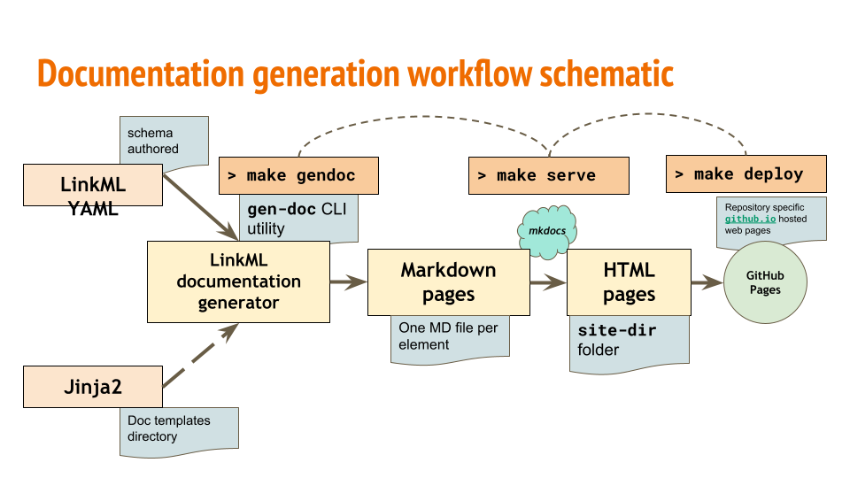

Documentation
=============

Overview
--------

Being able to automatically generate technical documentation pages for your LinkML schema is an
important feature of the LinkML framework. The linkml library is bundled with a generator (invoked
using the ``gen-doc`` command) which can be used to automatically create individual Markdown
pages for each of the elements (classes, slots, enumerations, etc.) in your schema.

The documentation pages are an important resource for consumers of the schema because it provides a
user-friendly way for users to explore and understand your schema.

If you use the official `LinkML Project Copier <https://github.com/linkml/linkml-project-copier>`_
template to create your schema, it will add a static site generator framework to your environment. There
are many static site generator frameworks available, but the one recommended by LinkML is `MkDocs <https://www.mkdocs.org/>`_.
MkDocs can be used to convert Markdown files/pages into HTML pages. The reason we recommend converting to
HTML is so that the pages can be deployed to a static site hosting service like `GitHub Pages <https://pages.github.com/>`_. Again,
if you have used the project template to create your schema, you will find a ``justfile`` in your project folder
with commands to help you build and deploy your documentation easily.

Another important detail about the information contained in the technical documentation pages is the fact
that it also has automatically generated `Mermaid class diagrams <https://mermaid.js.org/syntax/classDiagram.html>`_
embedded on the class documentation pages. These diagrams summarize the relationships between various classes
and slots in your schema.

Optionally linkml also allows you to exercise more granular control on the layout and content rendered on your documentation pages.
This customization is facilitated by the modification of the `base jinja2 templates <https://github.com/linkml/linkml/tree/main/packages/linkml/src/linkml/generators/docgen>`_
that are used to control the layout and content of the documentation pages. There are jinja2 templates for each of the elements
in your schema, and you can modify whichever you need to based on your requirements.

*Figure.: schematic diagram explaining the working mechanism of the ``gen-doc`` module*

Page names
^^^^^^^^^^

``gen-doc`` writes the index to ``index.md``. Use ``--index-name`` to give it another name, for
example when your static site generator reads ``index.md`` as the folder's own page, or when
your schema has a slot named ``index``:

.. code-block:: bash

    gen-doc --index-name overview -d docs/elements schema.yaml

Each element gets a page named after it: a class in CamelCase (``Person.md``), a slot in
snake_case (``home_address.md``), and each imported module under its schema name.

By default all pages share one folder. When two would share a file name, compared without case
because ``Person.md`` and ``person.md`` are one file on macOS and Windows, the later page gets its
kind as a suffix (``Person-slot.md``) and ``gen-doc`` logs a warning naming both. The index keeps
its name, then classes, slots, enums, types, subsets and modules in that order. Links always
point to the page's final name.

``--subfolder-type-separation`` puts each kind in its own folder (``classes/``, ``slots/``, ...),
so a class and a slot can share a name without a suffix. It changes every page's address.

Command Line
^^^^^^^^^^^^

.. currentmodule:: linkml.generators.docgen

.. click:: linkml.generators.docgen:cli
    :prog: gen-doc
    :nested: short

Code
^^^^

.. autoclass:: DocGenerator
    :members: serialize
